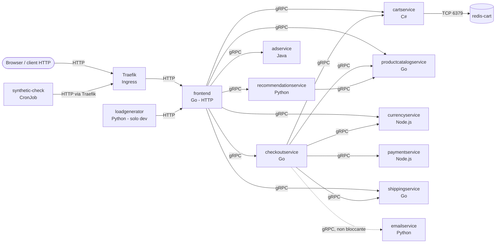
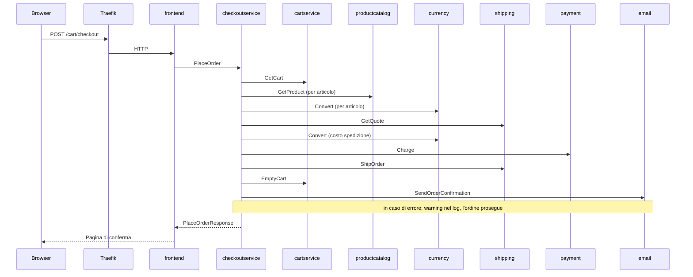
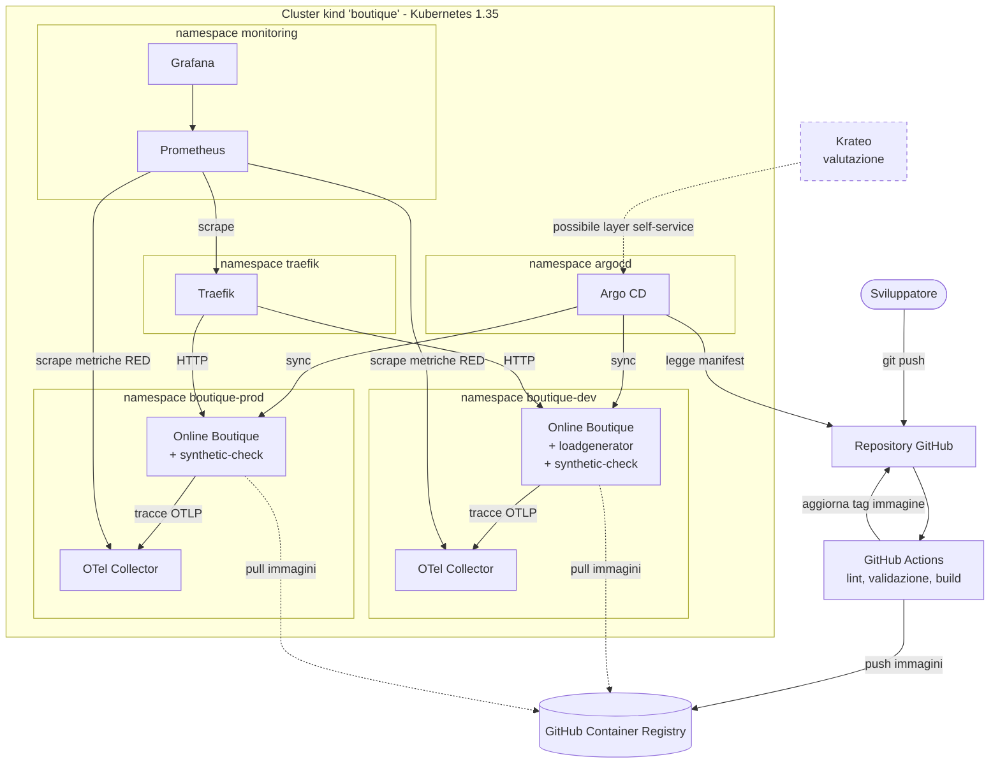
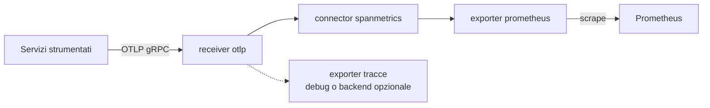

# Architettura della soluzione

## 1. Scopo

Questo documento descrive l'architettura logica e tecnica della piattaforma realizzata per la challenge: l'applicazione di riferimento, i componenti di piattaforma che la rilasciano e la rendono osservabile, le scelte tecnologiche con i relativi compromessi e i limiti noti.

Applicazione di riferimento: [Online Boutique](https://github.com/GoogleCloudPlatform/microservices-demo), versione upstream **v0.10.7**.

## 2. Vista logica dell'applicazione

Online Boutique è un e-commerce dimostrativo composto da 11 microservizi in 5 linguaggi più Redis. Il browser comunica in HTTP solo con il frontend; tutte le comunicazioni interne sono gRPC, con contratti definiti in `protos/demo.proto`.

## 3. Componenti e responsabilità

| Componente | Linguaggio | Porta Service → container | Responsabilità | Dipendenze | Tracing |
|---|---|---|---|---|---|
| frontend | Go | 80 → 8080 | Pagine web, orchestrazione delle chiamate, sessione utente | 7 servizi gRPC | sì |
| checkoutservice | Go | 5050 | Orchestrazione dell'ordine | cart, productcatalog, currency, shipping, payment, email | sì |
| recommendationservice | Python | 8080 | Prodotti consigliati | productcatalog | sì |
| cartservice | C# (.NET) | 7070 | Gestione del carrello | redis-cart | no |
| redis-cart | Redis | 6379 | Persistenza dei carrelli (unico componente stateful) | — | — |
| productcatalogservice | Go | 3550 | Catalogo prodotti da file JSON | — | sì |
| currencyservice | Node.js | 7000 | Conversione valuta | — | sì |
| paymentservice | Node.js | 50051 | Pagamento simulato | — | sì |
| shippingservice | Go | 50051 | Preventivo e spedizione simulati | — | no |
| emailservice | Python | 5000 → 8080 | Email di conferma simulata | — | sì |
| adservice | Java | 9555 | Annunci contestuali | — | no |
| loadgenerator | Python (Locust) | — | Traffico sintetico continuo (solo dev) | frontend | no |
| synthetic-check | CronJob (curl) | — | Verifica periodica end-to-end degli endpoint principali | Traefik, frontend | — |

Note:
- I servizi senza dipendenze (productcatalog, currency, payment, shipping, email, ad) sono "foglie": un loro guasto si manifesta solo nei flussi che li usano. productcatalogservice è usato da quasi tutti i flussi ed è il punto più critico.
- shoppingassistantservice (presente in upstream) è escluso: dipende da servizi AI e database di Google Cloud. Il frontend richiede comunque la variabile `SHOPPING_ASSISTANT_SERVICE_ADDR` all'avvio (va in crash se manca), che quindi viene mantenuta.

## 4. Flussi principali

### 4.1 Endpoint esposti dal frontend

| Metodo | Endpoint | Funzione |
|---|---|---|
| GET | `/` | Home con catalogo |
| GET | `/product/{id}` | Pagina prodotto |
| GET / POST | `/cart` | Visualizza carrello / aggiunge un prodotto |
| POST | `/cart/empty` | Svuota il carrello |
| POST | `/setCurrency` | Cambio valuta |
| POST | `/cart/checkout` | Ordine |
| GET | `/product-meta/{ids}` | Dati dei prodotti |
| GET | `/_healthz` | Health check (liveness e readiness) |

### 4.2 Checkout

È il flusso più significativo: attraversa sei servizi ed è quello in cui emergono i guasti dei servizi foglia.

Criticità delle dipendenze:
- **Bloccanti**: carrello, catalogo, valuta, spedizione e pagamento. Un loro errore fa fallire l'ordine.
- **Non bloccante**: email. Se l'invio fallisce, checkoutservice registra un warning (`failed to send order confirmation`) e l'ordine va comunque a buon fine (`src/checkoutservice/main.go`). È un esempio di degrado controllato.

## 5. Vista di piattaforma

## 6. Osservabilità

| Segnale | Fonte | Note |
|---|---|---|
| Health check | Probe gRPC native del kubelet sui servizi gRPC; HTTP `/_healthz` sul frontend | Il frontend non verifica i servizi a valle (sezione 10) |
| Log | JSON strutturato nei servizi Go e in Traefik (log generali e access log) | Formato degli altri servizi da verificare |
| Metriche applicative | Metriche RED (rate, errori, durata) derivate dalle tracce tramite il connettore spanmetrics dell'OpenTelemetry Collector | 7 servizi strumentati direttamente; cart, shipping e ad osservabili tramite gli span lato client di chi li chiama (da verificare) |
| Metriche di ingresso | Traefik (richieste, codici di risposta, latenza per router) | Esposte nativamente in formato Prometheus |
| Verifica end-to-end | synthetic-check: log strutturati con esito e tempi per endpoint | Copre il limite della readiness del frontend |
| Tracce | Ricevute dal Collector | Backend di visualizzazione opzionale (sezione 11) |

Pipeline del Collector (configurazione propria, una istanza per ambiente):

Il template del Collector incluso in upstream esporta solo verso Google Cloud e usa un init container che interroga il metadata server di GCP: non è utilizzabile su kind. Viene sostituito da una configurazione propria che riusa la stessa immagine (`otel/opentelemetry-collector-contrib`, già fissata per digest in upstream).

## 7. Mappatura sui componenti richiesti

| Componente richiesto | Realizzazione |
|---|---|
| Client / API consumer | Browser, loadgenerator (dev), synthetic-check |
| Ingress o Route | Traefik con risorse Ingress standard; host `boutique-dev.localhost` e `boutique.localhost` sulla porta 8080 |
| API Service | frontend: endpoint HTTP (sezione 4.1). Restituiscono HTML, non JSON: limite dichiarato dell'applicazione scelta |
| Worker / componente asincrono | Online Boutique non ne ha (il checkout è sincrono). Aggiunto synthetic-check: CronJob che verifica periodicamente gli endpoint principali e scrive log strutturati con esito e tempi |
| Database, cache, broker | redis-cart (stato dei carrelli). Nessun message broker nell'applicazione |
| ConfigMap e Secret | Configurazione del frontend, del synthetic-check e del Collector in ConfigMap; credenziali separate dal codice in Secret (dettaglio allo step 5) |
| CI/CD o GitOps | GitHub Actions per validazione e build; Argo CD per il deploy pull-based dal repository |
| Monitoring e logging | Sezione 6 |
| Krateo | Valutato come layer di self-service e catalogo sopra il chart e Argo CD (documento dedicato) |

## 8. Ambienti

Due ambienti logici nello stesso cluster, separati per namespace e configurati con file di values distinti dello stesso chart. Differenze previste (da confermare allo step 5):

| Aspetto | dev | prod |
|---|---|---|
| Namespace | boutique-dev | boutique-prod |
| Host | boutique-dev.localhost:8080 | boutique.localhost:8080 |
| Repliche dei servizi stateless critici | 1 | 2 |
| loadgenerator | attivo | disattivo |
| Immagini | ultima build di main | versione promossa e fissata |
| Risorse (requests/limits) | ridotte | dimensionate |
| Persistenza di Redis | emptyDir | da valutare (volume persistente) |

## 9. Scelte tecnologiche e compromessi

| Scelta | Motivazione | Alternative considerate |
|---|---|---|
| kind (multi-nodo) | Vicino a Kubernetes upstream, creazione e distruzione rapide, riproducibile | minikube, k3d |
| Traefik | ingress-nginx ritirato a marzo 2026; Traefik è mantenuto, supporta Ingress e Gateway API, espone metriche e log JSON | Envoy Gateway, Gateway API nativa |
| Helm (chart di upstream esteso) | Il chart di upstream copre già service account, NetworkPolicy e securityContext; il chart è il formato richiesto da Krateo | Kustomize (presente in upstream), chart da zero |
| Argo CD | Modello pull: funziona con un cluster locale non raggiungibile da Internet; separa CI (GitHub) da CD (cluster) | Flux, deploy push da GitHub Actions |
| OpenTelemetry Collector con spanmetrics | Metriche RED senza modifiche al codice, sfruttando la strumentazione già presente; tracce disponibili per il troubleshooting. Configurazione propria al posto di quella di upstream (solo Google Cloud) | Endpoint /metrics aggiunto al frontend (metrica di business, ma richiede modifiche al codice); sole metriche di Traefik (solo ingresso) |
| CronJob synthetic-check | Copre il ruolo di job e la verifica end-to-end che la probe del frontend non fa | Riuso del loadgenerator come "worker" |

## 10. Limiti e rischi noti

- **Readiness del frontend superficiale**: `/_healthz` risponde `ok` senza verificare i servizi a valle. Evita riavvii a cascata, ma il frontend risulta pronto anche quando non può servire pagine complete. Mitigazione: synthetic-check.
- **Copertura del tracing parziale**: cartservice, shippingservice e adservice non sono strumentati; le loro metriche derivano solo dagli span lato client dei chiamanti.
- **Metriche tecniche, non di business**: le metriche RED misurano chiamate ed errori; il numero di ordini è approssimato dalle chiamate riuscite a PlaceOrder.
- **Redis non persistente**: dati in emptyDir, persi alla ricreazione del pod; immagine con tag mobile in upstream (da fissare).
- **Endpoint non REST**: il frontend restituisce HTML.
- **Ambienti nello stesso cluster**: separazione logica (namespace, NetworkPolicy), non fisica.
- **Porte non standard**: ingress su 127.0.0.1:8080/8443 perché 80/443 sono occupate sulla workstation di sviluppo.

## 11. Punti di estensione

- Krateo come portale self-service e catalogo sopra chart e Argo CD.
- Migrazione da Ingress a Gateway API (Traefik la supporta già).
- Redis gestito o con volume persistente; cartservice supporta anche database esterni (`cartDatabase` nel chart).
- Backend di tracce (ad esempio Jaeger) collegato al Collector.
- Strumentazione OpenTelemetry di cartservice, shippingservice e adservice.